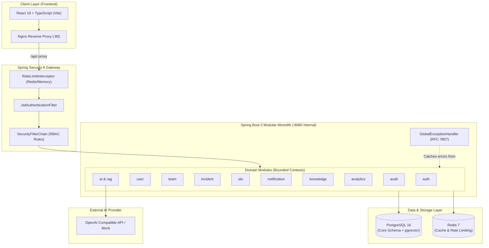
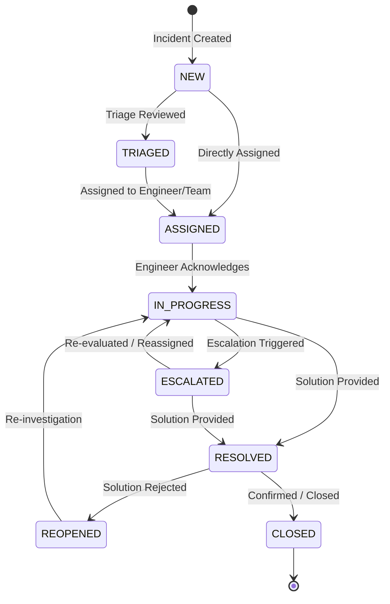

# ResolveAI — AI-Powered Enterprise Incident & Service Management Platform

ResolveAI is an enterprise-grade incident and IT service management platform engineered with modern full-stack practices. It streamlines technical incident triage, SLA enforcement, team assignment, resolution workflows, and knowledge base lookups, augmented by resilient AI assistance and evidence-grounded Retrieval-Augmented Generation (RAG).

---

## Table of Contents

- [Overview & Problem Statement](#overview--problem-statement)
- [Key Features](#key-features)
- [Architecture Principles](#architecture-principles)
- [High-Level Architecture Diagrams](#high-level-architecture-diagrams)
- [Technology Stack](#technology-stack)
- [User Roles & Permissions Matrix](#user-roles--permissions-matrix)
- [Incident Lifecycle & State Machine](#incident-lifecycle--state-machine)
- [AI Advisory Foundation & Grounded RAG](#ai-advisory-foundation--grounded-rag)
- [Configurable SLA Engine & Notifications](#configurable-sla-engine--notifications)
- [Real-Time Operational Analytics](#real-time-operational-analytics)
- [Redis Caching & Distributed Rate Limiting](#redis-caching--distributed-rate-limiting)
- [Production Hardening & Security](#production-hardening--security)
- [Docker & Container Architecture](#docker--container-architecture)
- [Cloud Deployment Readiness](#cloud-deployment-readiness)
- [Continuous Integration (GitHub Actions)](#continuous-integration-github-actions)
- [Project Documentation Index](#project-documentation-index)
- [Prerequisites](#prerequisites)
- [Local Setup & Getting Started](#local-setup--getting-started)
- [Configuration & Environment Variables](#configuration--environment-variables)
- [Automated Testing Harness](#automated-testing-harness)
- [End-to-End Demonstration Sequence](#end-to-end-demonstration-sequence)
- [Screenshot Checklist & Presentation Outline](#screenshot-checklist--presentation-outline)
- [Common Troubleshooting](#common-troubleshooting)
- [Development Phases & Roadmap](#development-phases--roadmap)
- [License](#license)

---

## Overview & Problem Statement

In enterprise IT operations, resolving service outages rapidly while maintaining transparent, auditable communication is vital. Service desks frequently face:
1. **Alert Fatigue & Triaging Bottlenecks**: Engineers spend valuable minutes categorizing and prioritizing tickets manually.
2. **SLA Breaches**: Static SLA thresholds fail to adapt to variable urgency, leading to missed client commitments.
3. **Siloed Knowledge**: Solutions discovered in past outages are buried in tickets, leading to repeated diagnosis efforts.
4. **Unreliable AI Hallucinations**: Generic AI tools generate inaccurate solutions and mutate production state without oversight.

**ResolveAI** solves these challenges by combining strict ITIL state machine governance with an **evidence-grounded AI advisory copilot**:
- **Employees** report technical issues, monitor ticket progress in real time, and search the knowledge base.
- **Engineers** triage, diagnose, investigate, and resolve incidents with context-aware AI recommendations grounded in cited knowledge articles and historical tickets.
- **Managers** route incidents across squads, balance team workloads, and govern Service Level Agreements (SLAs).
- **Admins** manage users, roles, teams, category taxonomy, audit logs, and SLA policies.

> [!IMPORTANT]
> **Advisory-Only Guarantee**: AI recommendations operate strictly as a human-in-the-loop copilot. AI analysis endpoints are strictly read-only (`@Transactional(readOnly = true)`) and **never** mutate database rows automatically.

---

## Key Features

1. **Strict Incident Lifecycle Governance**: Enforced state machine (`NEW` → `TRIAGED` → `ASSIGNED` → `IN_PROGRESS` → `RESOLVED` → `CLOSED`, with `ESCALATED` and `REOPENED` loops) with immutable audit history.
2. **Dynamic SLA Policy Engine**: Priority-driven policies (P1 to P4) dynamically computing response and resolution deadlines with automated breach tracking and alerts.
3. **Role-Based & Resource-Level Authorization**: Granular RBAC ensuring employees view only their tickets, engineers view their assigned/team queues, managers supervise department workloads, and admins configure policies.
4. **ITIL Knowledge Base**: Full lifecycle management (`DRAFT` → `PUBLISHED` → `ARCHIVED`) with symptom/cause/resolution categorization and relational ticket linking.
5. **Grounded RAG & Vector Search**: `pgvector` HNSW cosine similarity search over 1536-dimensional embeddings, delivering diagnostics grounded in published articles and historical tickets with explicit citations.
6. **In-App Notification Engine**: Event-driven alerts on assignment changes, status transitions, comments, and impending SLA breaches.
7. **Real-Time Operational Analytics**: Push-down database aggregations calculating MTTR, SLA compliance rates, and queue distributions without a secondary data warehouse.
8. **Distributed Rate Limiting**: Redis sliding-window counters with thread-safe in-memory fallback protecting authentication and AI endpoints.
9. **Defense-in-Depth Security**: Dual-tier stateless JWTs, BCrypt password hashing, and hardened HTTP headers across Spring Security and Nginx.
10. **Containerized Architecture**: Multi-stage Docker builds orchestrated via Docker Compose with private bridge network isolation.

---

## Architecture Principles

- **Modular Monolith**: Organized into clean bounded contexts (`auth`, `user`, `team`, `incident`, `sla`, `notification`, `knowledge`, `analytics`, `ai`, `audit`, `common`).
- **Layered Pattern**: Strict `Controller` → `Service` → `Repository` → `Database` flow.
- **DTO Boundaries**: Zero exposure of JPA entities in REST contracts; all payloads are validated Data Transfer Objects.
- **Consistent Error Normalization**: Centralized global exception handler emitting standard RFC 7807 problem envelopes.
- **Resilient Auxiliary AI**: Decoupled AI provider interfaces; platform operates at 100% capacity even if external AI models are offline (HTTP 503 fallback).

---

## High-Level Architecture Diagrams

### System Architecture



---

## Technology Stack

### Backend
- **Language**: Java 21 (LTS)
- **Framework**: Spring Boot 3.3+
- **Security**: Spring Security 6, Stateless JWT (JJWT), BCrypt password hashing
- **Persistence**: Spring Data JPA, Hibernate 6, PostgreSQL 16
- **Vector Search**: PostgreSQL `pgvector` with HNSW cosine distance indexing
- **Database Migrations**: Flyway (vendor profiles for PostgreSQL and H2 test mode)
- **Caching & Rate Limiting**: Redis 7 (Lettuce client) with in-memory fallback
- **Validation**: Jakarta Bean Validation (`hibernate-validator`)
- **Documentation**: OpenAPI 3 / Swagger (SpringDoc)

### Frontend
- **Framework**: React 18 with TypeScript 5
- **Build Tool**: Vite 5
- **HTTP Client**: Axios with centralized request/response interceptors
- **Styling**: Modern responsive CSS / Tailwind CSS variables
- **Icons**: Lucide React

### Testing & DevOps
- **Automated Testing**: JUnit 5, Mockito, Spring Boot Test, H2 in-memory (PostgreSQL mode)
- **Containers**: Multi-stage Dockerfiles for Backend & Frontend
- **Orchestration**: Docker Compose (PostgreSQL, Redis, Spring Boot, Nginx)
- **CI/CD**: GitHub Actions matrix pipelines (`backend-ci`, `frontend-ci`, `docker-ci`)

---

## User Roles & Permissions Matrix

ResolveAI implements a defense-in-depth authorization model combining stateless JWT identity verification with Spring Security method-level access control:

| Resource / Action | EMPLOYEE | ENGINEER | MANAGER | ADMIN |
| :--- | :---: | :---: | :---: | :---: |
| **Create Incident** | Yes | Yes | Yes | Yes |
| **View Own Reported Incidents** | Yes | Yes | Yes | Yes |
| **View Team Incidents** | No | Yes (Assigned) | Yes (All Team) | Yes (All) |
| **View All Enterprise Incidents** | No | No | No | Yes |
| **Change Incident Status** | No | Yes (Assigned) | Yes | Yes |
| **Assign / Reassign Incidents** | No | No | Yes | Yes |
| **Add Public Customer Comment** | Yes (Own) | Yes (Assigned) | Yes | Yes |
| **Add Internal Investigation Note** | No | Yes | Yes | Yes |
| **View Published Knowledge Articles**| Yes | Yes | Yes | Yes |
| **Create / Publish Knowledge Articles**| No | Yes | Yes | Yes |
| **View Team Analytics & SLA** | No | No | Yes | Yes |
| **Configure SLA Policies** | No | No | Yes | Yes |
| **User & Team Administration** | No | No | Yes (Teams) | Yes |
| **View System Audit Logs** | No | No | No | Yes |

---

## Incident Lifecycle & State Machine



- **Enforcement**: Invalid transitions throw `InvalidStateTransitionException` returning `HTTP 400 Bad Request`.
- **Audit Logging**: Every status transition or assignment mutation appends an immutable record to `incident_history`.

---

## AI Advisory Foundation & Grounded RAG

ResolveAI separates AI functionality into two distinct phases:

### Phase 10: AI Advisory Foundation
- **Endpoint**: `POST /api/ai/incidents/{id}/analyze`
- **Output**: Advisory categorization, priority suggestion, severity recommendation, and executive summary.
- **Safety**: Read-only transaction (`@Transactional(readOnly = true)`).

### Phase 11: Grounded RAG Pipeline
- **Endpoint**: `POST /api/ai/incidents/{id}/rag-analyze`
- **Vector Search Engine**: `pgvector` HNSW index matching over 1536-dimensional dense vectors.
- **Dual Vector Retrieval**:
  - Top-K published Knowledge Articles.
  - Top-K resolved historical incidents.
- **Evidence-Grounded Prompt**: The LLM synthesizes diagnosis and resolution guidance while citing exact source metadata (`sourceType`, `sourceId`, `title`, `similarity`, `reference`, `snippet`).
- **Resilience**: If the AI provider is unavailable, returns `503 Service Unavailable` without impacting core ticketing workflows.

---

## Configurable SLA Engine & Notifications

- **Dynamic Deadlines**: Calculations driven by the `sla_policies` table (P1 Critical: 15m response / 2h resolution; P2 High: 30m / 8h; P3 Medium: 2h / 24h; P4 Low: 4h / 72h).
- **First Response Tracking**: The first acknowledgment stamps `responded_at`. If `responded_at > response_due_at`, flags `is_response_breached = true`.
- **Resolution Tracking**: Transition to `RESOLVED` stamps `resolved_at`.
- **In-App Notifications**: Dispatched on incident creation, assignment changes, status updates, comments, and SLA breaches. Includes unread counters and atomic `PATCH /api/notifications/read-all` bulk updates.

---

## Real-Time Operational Analytics

Accessible to managers and admins (`/api/analytics/*`):
- **Overview Metrics**: Total incidents, open queue count, resolved/closed tickets, critical P1 tickets.
- **Mean Time to Resolve (MTTR)**: Real-time calculation across resolved incidents.
- **SLA Compliance Rate**: Calculated percentage compliance and breach counts.
- **Team Workload Breakdown**: Active ticket counts per engineering squad.
- **Push-Down Aggregations**: Calculated directly in PostgreSQL using JPQL expressions (`COUNT`, `SUM(CASE WHEN...)`, `AVG`) without in-memory entity streaming.

---

## Redis Caching & Distributed Rate Limiting

- **Cache-Aside (`@Cacheable`)**:
  - `knowledge_articles` (TTL: 30 minutes): Cached by ID for `PUBLISHED` articles. `DRAFT` and `ARCHIVED` articles bypass cache to enforce real-time RBAC checks.
  - `teams` and `team_members` (TTL: 30–60 minutes): Evicted immediately on updates.
  - Fail-safe fallback: Redis timeouts gracefully fall through to PostgreSQL without failing user transactions.
- **Distributed Sliding-Window Rate Limiting**:
  - Enforced via `RateLimitInterceptor` with custom `@RateLimit` annotations.
  - Endpoints protected:
    - `POST /api/auth/register`: 10 requests / 60 seconds
    - `POST /api/auth/login`: 15 requests / 60 seconds
    - `POST /api/auth/refresh`: 30 requests / 60 seconds
    - `POST /api/ai/incidents/{id}/analyze`: 20 requests / 60 seconds
    - `POST /api/ai/incidents/{id}/rag-analyze`: 20 requests / 60 seconds
  - Over-limit requests return `HTTP 429 Too Many Requests` with a `Retry-After: {seconds}` header.

---

## Production Hardening & Security

- **Security Headers**: Enforced across Spring Security filter chain and Nginx:
  - `X-Frame-Options: DENY` (Clickjacking mitigation)
  - `X-Content-Type-Options: nosniff` (MIME sniffing prevention)
  - `X-XSS-Protection: 1; mode=block`
  - `Strict-Transport-Security: max-age=31536000; includeSubDomains` (HSTS)
  - `Referrer-Policy: strict-origin-when-cross-origin`
  - `Permissions-Policy: camera=(), microphone=(), geolocation=()`
- **Server Banners**: `server_tokens off` hides Nginx versions.
- **Actuator Endpoint Security**: `/actuator/health` is public; sensitive diagnostic endpoints (`/actuator/beans`, etc.) require authentication.
- **Non-Root Execution**: Docker container runs Spring Boot under a dedicated unprivileged user (`spring`).

---

## Docker & Container Architecture

| Service | Container Name | Base Image | Internal Port | Host Port | Purpose |
| :--- | :--- | :--- | :--- | :--- | :--- |
| **PostgreSQL** | `resolveai-postgres` | `pgvector/pgvector:pg16` | `5432` | `5432` | Primary database with `pgvector` HNSW indexes |
| **Redis** | `resolveai-redis` | `redis:7-alpine` | `6379` | `6379` | Cache and sliding-window rate limiter with AOF |
| **Backend** | `resolveai-backend` | `eclipse-temurin:21-jre-alpine` | `8080` | *Internal* | Spring Boot 3 modular monolith API |
| **Frontend** | `resolveai-frontend` | `nginx:alpine` | `80` | `80` | React SPA + reverse proxy (`/api/` -> `backend:8080`) |

> [!NOTE]
> **Host Port 8080 Conflict Prevention**: The backend container communicates with Nginx over the internal Docker network `resolveai-network:8080`. Host port 8080 is not exposed, avoiding conflicts with local services like Jenkins.

---

## Cloud Deployment Readiness

ResolveAI is container-ready for deployment across cloud platforms supporting Docker workloads (AWS ECS, GCP Cloud Run, Azure Container Apps, Render, Fly.io):
- Activate production profile with `SPRING_PROFILES_ACTIVE=prod`.
- Enables graceful server shutdown (`server.shutdown: graceful`, 30s timeout).
- HikariCP connection pool tuning and Redis TLS encryption support.
- See [`docs/deployment/cloud-deployment.md`](docs/deployment/cloud-deployment.md) for the complete cloud checklist.

---

## Continuous Integration (GitHub Actions)

Orchestrated via `.github/workflows/ci.yml`:
- **Concurrency Control**: Automatically cancels obsolete in-progress pipeline runs on push.
- **`backend-ci`**: Ubuntu, JDK 21 (Temurin), Maven cache -> Executes full 282-test suite.
- **`frontend-ci`**: Ubuntu, Node 20, npm cache -> `npm ci` and `npm run build` (tsc + Vite bundle).
- **`docker-ci`**: Ubuntu, Docker Buildx -> `docker compose config` syntax validation and image build checks.

---

## Project Documentation Index

Comprehensive documentation is available in the [`docs/`](docs/) directory:

- [System Architecture Specification](docs/architecture/architecture.md): Modular architecture, bounded contexts, and 7 Mermaid diagrams.
- [Database Schema & ER Diagram](docs/database/database-design.md): PostgreSQL schema, 15 core entities + 2 pgvector tables, and Flyway vendor migrations.
- [REST API Reference](docs/api/api-plan.md): Complete endpoint catalog, status codes, DTOs, and error envelopes.
- [AI & Grounded RAG Architecture](docs/ai/ai-rag-architecture.md): Technical deep-dive into AI abstraction, vector search, and citation mechanisms.
- [Security Architecture & Hardening](docs/security/security-architecture.md): JWT strategy, RBAC matrix, rate limiting, and security headers.
- [Cloud Deployment Readiness Guide](docs/deployment/cloud-deployment.md): Environment variables, container configuration, and rollback strategies.
- [End-to-End Demonstration Guide](docs/demo/resolveai-demo-guide.md): Repeatable 14-step demonstration walkthrough for evaluations and interviews.
- [Project Showcase & Presentation Outline](docs/demo/presentation-and-screenshots.md): Screenshot checklist and 10–15 minute presentation script with Q&A defense.
- [Development Roadmap](docs/development-roadmap.md): Complete 19-phase engineering roadmap.

---

## Prerequisites

- **Java Development Kit (JDK)**: Version 21 or higher
- **Node.js**: Version 20.x LTS or higher (with npm 10+)
- **PostgreSQL**: Version 16 (or Docker)
- **Docker & Docker Compose**: Docker Desktop or Docker Engine (v2.20+)
- **Git**: Version 2.40+

---

## Local Setup & Getting Started

### Option A: Quick Start with Docker Compose (Recommended)

```bash
# 1. Clone repository
git clone git@github.com:shanmukhveeravalli/ResolveAI.git
cd ResolveAI

# 2. Configure environment
cp .env.example .env

# 3. Build and launch all 4 containers in the background
docker compose up --build -d

# 4. Check container health status
docker compose ps

# 5. Access the applications
# Frontend Web App & API Proxy: http://localhost (port 80)
# Backend Health Endpoint: http://localhost/api/health
```

### Option B: Local Development Setup (Manual)

1. **Start Database & Redis**:
   ```bash
   docker compose up -d postgres redis
   ```
2. **Run Backend (Spring Boot 3 + Java 21)**:
   ```bash
   cd backend
   mvn spring-boot:run
   ```
   - API Base URL: `http://localhost:8080/api`
   - Health Probe: `http://localhost:8080/api/health`
   - Swagger UI: `http://localhost:8080/swagger-ui.html`
3. **Run Frontend (React 18 + Vite)**:
   ```bash
   cd frontend
   npm install
   npm run dev
   ```
   - Frontend Web App: `http://localhost:5173`

---

## Configuration & Environment Variables

Key environment variables configured in `.env`:

| Variable | Description | Example Default |
| :--- | :--- | :--- |
| `SPRING_PROFILES_ACTIVE` | Active Spring profile | `dev` (or `prod`) |
| `DB_HOST` | PostgreSQL host | `localhost` (or `postgres` in Docker) |
| `DB_PORT` | PostgreSQL port | `5432` |
| `DB_NAME` | Database name | `resolveai_db` |
| `DB_USERNAME` | Database username | `postgres` |
| `DB_PASSWORD` | Database password | *(secure password)* |
| `JWT_SECRET` | 256-bit secret key for HMAC-SHA256 | *(base64 encoded 32+ byte string)* |
| `JWT_ACCESS_EXPIRATION` | Access token lifespan (ms) | `900000` (15 minutes) |
| `JWT_REFRESH_EXPIRATION` | Refresh token lifespan (ms) | `604800000` (7 days) |
| `REDIS_HOST` | Redis host | `localhost` (or `redis` in Docker) |
| `REDIS_PORT` | Redis port | `6379` |
| `AI_ENABLED` | Master AI toggle | `false` (or `true`) |
| `AI_PROVIDER` | AI provider implementation | `mock` (or `openai`) |
| `AI_API_KEY` | LLM provider API key | *(optional, required if provider=openai)* |

---

## Automated Testing Harness

```bash
# Run all backend unit, security, and integration tests (282 tests)
cd backend
mvn test

# Run a focused test suite
mvn test "-Dtest=Phase17SecurityHardeningTest,RateLimiterServiceTest"

# Verify frontend TypeScript types and production bundling
cd ../frontend
npm run build
```

---

## End-to-End Demonstration Sequence

Follow the detailed walkthrough in [`docs/demo/resolveai-demo-guide.md`](docs/demo/resolveai-demo-guide.md):
1. **Start the Platform**: Verify container health via `docker compose ps` and `curl /api/health`.
2. **Authenticate**: Register demo user and login to receive access and refresh JWTs.
3. **Report Incident**: Submit technical issue; observe automated ticket ID and SLA record generation.
4. **Lifecycle Constraints**: Attempt invalid transition; observe deterministic HTTP 400 rejection.
5. **AI Advisory Triage**: Generate category, priority, and summary recommendations (read-only).
6. **Assign Incident**: Route ticket to squad; observe immutable history log and notifications.
7. **SLA Monitoring**: Inspect calculated response and resolution deadlines and breach flags.
8. **Comments & History**: Add internal diagnostic notes; inspect unread notification count.
9. **Knowledge Base**: Publish troubleshooting article and link to incident with conflict prevention.
10. **Grounded RAG**: Execute vector search over `pgvector`; inspect citations and confidence score.
11. **Operations Analytics**: Inspect live MTTR, SLA compliance rates, and squad workload charts.
12. **RBAC & Rate Limiting**: Verify 403 Forbidden on unauthorized roles and 429 on rapid requests.
13. **Container Architecture**: Review Docker bridge network isolation and non-root execution.
14. **CI Matrix**: Review GitHub Actions workflow and test suite execution.

---

## Screenshot Checklist & Presentation Outline

Refer to [`docs/demo/presentation-and-screenshots.md`](docs/demo/presentation-and-screenshots.md) for:
- **10-Point Screenshot Checklist**: Exact URLs and elements to capture for visual proof.
- **10–15 Minute Technical Presentation Script**: Slide-by-slide outline with talking points.
- **Architectural Defense Q&A**: Answers to anticipated technical questions (Modular Monolith vs Microservices, RAG Hallucination Safeguards, AI Outage Isolation).

---

## Common Troubleshooting

| Issue | Root Cause | Solution |
| :--- | :--- | :--- |
| **Port 8080 conflict on host** | Local Jenkins or dev service running on port 8080 | Docker Compose maps only port `80` to the host; backend is internal to Docker network. Access via `http://localhost/api/health`. |
| **HTTP 503 on AI endpoints** | AI disabled or unconfigured API key | Set `AI_ENABLED=true` and `AI_PROVIDER=mock` in `.env` for offline demonstration, or provide valid `AI_API_KEY`. |
| **HTTP 429 on auth endpoints** | Rate limit threshold exceeded | Wait 60 seconds or check the `Retry-After` header value in the response. |
| **Database connection failure** | PostgreSQL container not yet healthy | Verify `docker compose ps` shows `resolveai-postgres` healthy before backend start. |

---

## Development Phases & Roadmap

- **Phase 0**: Project Planning and Architecture ✅
- **Phase 1**: Backend/Frontend Project Setup ✅
- **Phase 2**: Database and Migrations (Flyway, PostgreSQL) ✅
- **Phase 3**: Authentication (JWT, BCrypt) ✅
- **Phase 4**: Role-Based & Resource-Level Authorization (RBAC) ✅
- **Phase 5**: Incident Management Core (Lifecycle, State Machine, History) ✅
- **Phase 6**: Teams and Assignment Engine ✅
- **Phase 7**: SLA Calculation & Breach Engine ✅
- **Phase 8**: In-App Notification System ✅
- **Phase 9**: Knowledge Base Module ✅
- **Phase 10**: AI Foundation (Summarization, Triage Suggestions) ✅
- **Phase 11**: Grounded RAG & Similarity Search (Vector Embeddings) ✅
- **Phase 12**: Analytics & Operational Metrics ✅
- **Phase 13**: Redis Caching & Cache-Aside ✅
- **Phase 14**: Docker & Containerization ✅
- **Phase 15**: CI/CD Pipelines (GitHub Actions) ✅
- **Phase 16**: Cloud Deployment Readiness ✅
- **Phase 17**: Production Hardening & Security (Rate Limiting, Security Headers) ✅
- **Phase 18**: Final Documentation, Diagrams, Demo Preparation & Release ✅

---

## License

ResolveAI is created for enterprise service management education and demonstration.
