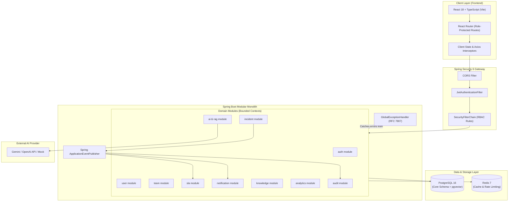
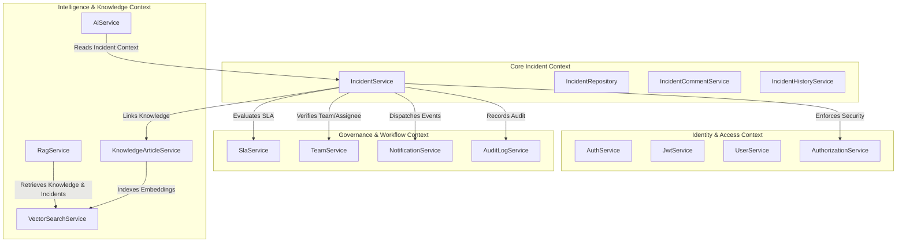
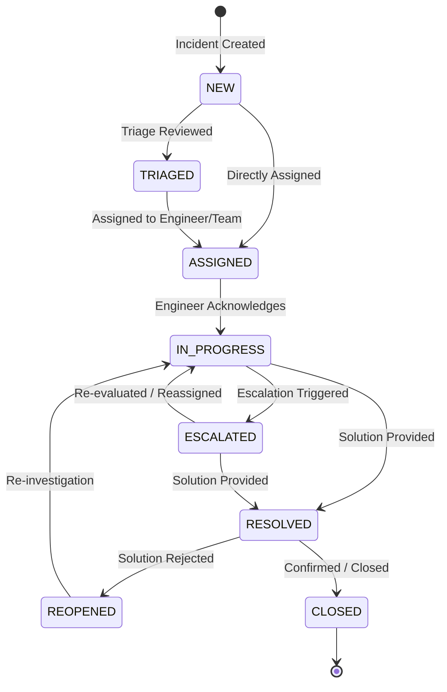
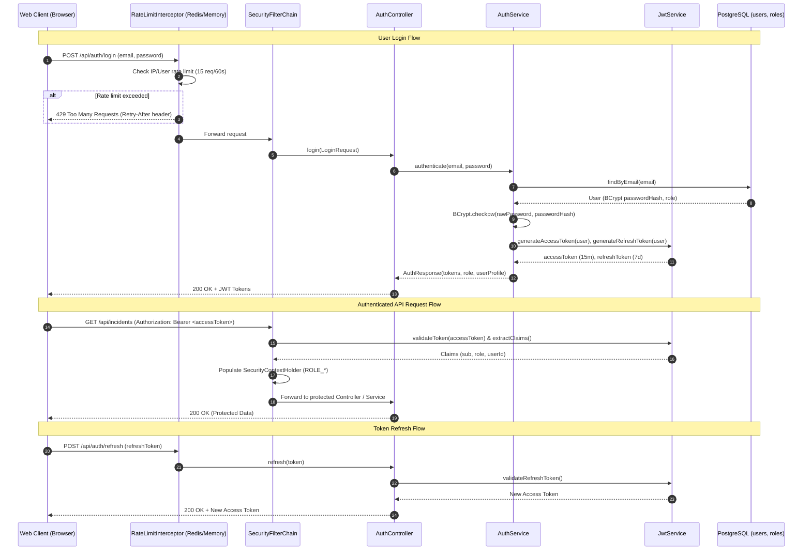
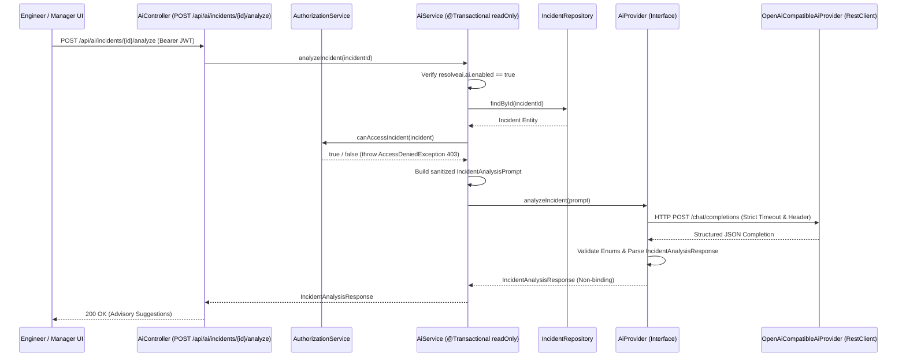
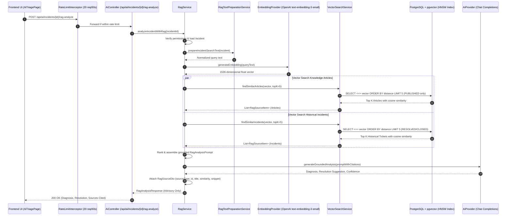
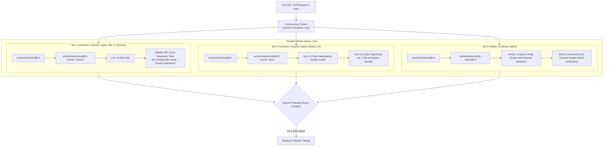

# ResolveAI — System Architecture Specification

## 1. Executive Architecture Summary

ResolveAI is designed as an **Enterprise Modular Monolith** implemented using **Java 21**, **Spring Boot 3.3+**, and **React 18 with TypeScript**.

### Architectural Decision: Modular Monolith vs. Microservices
For an enterprise incident management platform of this scope, a modular monolith was chosen over a distributed microservices architecture for key engineering reasons:
- **Transactional Integrity**: Incident state transitions, SLA record creation, and audit logging require strong ACID guarantees without the overhead of two-phase commits (2PC) or distributed saga orchestrators.
- **Maintainability & Operability**: Single deployable artifact reduces DevOps complexity, minimizes latency from inter-service network hops, and allows simpler local development and testing.
- **Strict Bounded Contexts**: Code is cleanly partitioned into domain packages (`auth`, `user`, `team`, `incident`, `sla`, `notification`, `knowledge`, `analytics`, `ai`, `audit`, `common`). Dependencies between modules are restricted to service interfaces and DTOs, avoiding tangled cross-domain entity dependencies.
- **Evolution Path**: Should team scale require independent deployment later, bounded contexts are already isolated and can be extracted into microservices without rewriting business logic.

---

## 2. High-Level System Architecture



---

## 3. Layered Pattern & Dependency Rules

Each domain module strictly adheres to a 4-tier layer pattern:

```
[ HTTP Requests ]
       ↓
 Controller (REST Endpoints, Request Validation, HTTP status codes)
       ↓
  Service   (Business logic, Transactions, Invariant rules, Domain Events)
       ↓
Repository (Spring Data JPA, Native/JPQL queries, Auditing)
       ↓
 Database  (PostgreSQL tables, Foreign keys, Check constraints, Indexes)
```

### Architectural Rules:
1. **No Business Logic in Controllers**: Controllers only receive DTOs, validate using `@Valid`, delegate to the appropriate Service, and wrap results in standard response structures.
2. **DTO Boundary Enforcement**: JPA Entities must **NEVER** be accepted as controller parameters or returned directly in API responses. DTOs insulate internal database schemas from external API contracts.
3. **Transaction Management**: `@Transactional` is declared at the Service layer with appropriate propagation (`REQUIRED`, `REQUIRES_NEW` for audit logging) and isolation levels (`READ_COMMITTED`).
4. **Inter-Module Communication**: Modules communicate by injecting target domain Service interfaces or publishing asynchronous/transactional application events (`@TransactionalEventListener`). Direct cross-module repository access is prohibited.

---

## 4. Domain Modules (Bounded Contexts)

| Module | Core Responsibility |
| :--- | :--- |
| `common` | Base entities, generic pagination DTOs, global exception handler, RFC error envelopes, constants. |
| `auth` | User registration, login, JWT token issuance/validation, refresh tokens, security principal resolution. |
| `user` | User profiles, account activation/deactivation, password management. |
| `team` | Team structures, department mapping, lead assignment, engineer roster management. |
| `incident` | Incident CRUD, state machine enforcement, assignment tracking, priority/severity, comments, attachments. |
| `sla` | SLA policy definition, deadline calculations (`response_due_at`, `resolution_due_at`), breach tracking. |
| `notification`| In-app notification delivery, unread badge counters, status change notifications. |
| `knowledge` | Knowledge base article lifecycle (Draft, Published, Archived), symptom/cause/resolution documentation. |
| `analytics` | Metric computation (MTTR, SLA compliance rates, workload distribution, trend analysis). |
| `audit` | Append-only security and operational audit trail recording actor, action, timestamp, diffs, and client IP. |
| `ai` | Resilient interface for incident summarization, category/severity suggestion, similarity search, and RAG advisory. |

### Component & Module Boundaries Diagram



---

## 5. Incident Lifecycle & State Machine

The incident state machine is the core workflow engine of ResolveAI. Any invalid transition throws an `InvalidStateTransitionException` resulting in an HTTP 400 Bad Request.



### Formal State Transition Table

| Source State | Allowed Destination States | Actor Roles Permitted | Conditions & Side Effects |
| :--- | :--- | :--- | :--- |
| `NEW` | `TRIAGED` | ENGINEER, MANAGER, ADMIN | Initial triage performed; category/priority reviewed. |
| `NEW` | `ASSIGNED` | MANAGER, ADMIN | Directly assigned to an engineer or team. |
| `TRIAGED` | `ASSIGNED` | MANAGER, ADMIN | Assignee or assigned team specified. |
| `ASSIGNED` | `IN_PROGRESS` | ENGINEER (assignee), MANAGER | Engineer acknowledges ticket; SLA `responded_at` stamped if null. |
| `IN_PROGRESS` | `ESCALATED` | ENGINEER, MANAGER, ADMIN | Escalation note required; notification sent to manager. |
| `ESCALATED` | `IN_PROGRESS` | MANAGER, ADMIN | Manager re-evaluates or reassigns ticket. |
| `IN_PROGRESS` | `RESOLVED` | ENGINEER, MANAGER, ADMIN | Resolution notes mandatory; SLA `resolved_at` stamped. |
| `ESCALATED` | `RESOLVED` | ENGINEER, MANAGER, ADMIN | Resolution notes mandatory; SLA `resolved_at` stamped. |
| `RESOLVED` | `REOPENED` | EMPLOYEE (reporter), MANAGER | Reopen reason mandatory; ticket returned to queue. |
| `REOPENED` | `IN_PROGRESS` | ENGINEER, MANAGER, ADMIN | Investigation resumes. |
| `RESOLVED` | `CLOSED` | EMPLOYEE, MANAGER, ADMIN, SYSTEM | Ticket confirmed resolved or closed automatically after 5 business days. |
| `CLOSED` | *None* | *None* | Final terminal state; immutable. |

### Invariant & History Rule
Every state change or assignee mutation triggers an immutable `IncidentHistory` entry recording:
- `incidentId`, `actorId`, `actionType` (`STATUS_CHANGE`, `ASSIGNMENT_CHANGE`, `PRIORITY_CHANGE`, etc.)
- `fieldName`, `oldValue`, `newValue`, and `timestamp`.

---

## 6. Security & Authorization Architecture

### 6.1 Authentication Mechanism
- **Stateless JWT**: Standard Authorization header format `Bearer <token>`.
- **Token Dual-Tier Strategy**:
  - **Access Token**: Short-lived (15 minutes), contains `sub` (user email), `userId`, and `role` claims.
  - **Refresh Token**: Long-lived (7 days), stored in the database with rotation and revocation support.
- **Password Security**: Passwords hashed using **BCrypt** (cost factor 12) with salted digests.

#### Authentication & JWT Lifecycle Flow



### 6.2 Role-Based Access Control (RBAC) Matrix

| Resource / Action | EMPLOYEE | ENGINEER | MANAGER | ADMIN |
| :--- | :---: | :---: | :---: | :---: |
| **Create Incident** | Yes | Yes | Yes | Yes |
| **View Own Reported Incidents** | Yes | Yes | Yes | Yes |
| **View Team Incidents** | No | Yes (Assigned) | Yes (All Team) | Yes (All) |
| **View All Enterprise Incidents** | No | No | No | Yes |
| **Change Incident Status** | No | Yes (Assigned) | Yes | Yes |
| **Assign / Reassign Incidents** | No | No | Yes | Yes |
| **Add Public Comment** | Yes (Own) | Yes (Assigned) | Yes | Yes |
| **Add Internal Diagnosis Note** | No | Yes | Yes | Yes |
| **View Knowledge Base** | Yes (Published) | Yes (All) | Yes (All) | Yes (All) |
| **Manage Knowledge Articles** | No | Yes (Create/Edit) | Yes | Yes |
| **View Team Analytics & SLA** | No | No | Yes | Yes |
| **Configure SLA Policies** | No | No | Yes | Yes |
| **User & Team Administration** | No | No | Yes (Teams) | Yes |
| **View System Audit Logs** | No | No | No | Yes |

### 6.3 Resource-Level Security
In addition to role checks (`@PreAuthorize("hasRole('ENGINEER')")`), method-level resource ownership checks ensure that:
- Employees cannot fetch `/api/incidents/{id}` unless `incident.reporterId == currentUserId`.
- Engineers can update incidents only if they are assigned to the incident or belong to the assigned team.
- Knowledge base articles in `DRAFT` or `ARCHIVED` status cannot be accessed or listed by standard employees, nor by other engineers who are not the author (only the author or managers/admins may access draft/archived articles).
- Incident-knowledge linking (`incident_knowledge_links`) strictly enforces incident accessibility and caller visibility over the linked article.

### 6.4 Knowledge Base Lifecycle & Linking
Knowledge Base articles follow a strict ITIL lifecycle:
- **`DRAFT` → `PUBLISHED`**: Publishes article, populating `published_at` timestamp. Accessible by author engineer, manager, or admin.
- **`DRAFT` → `ARCHIVED`**: Retires a draft article without publication.
- **`PUBLISHED` → `ARCHIVED`**: Deprecates a published article.
- All other state transitions (such as `ARCHIVED` → `PUBLISHED` or `ARCHIVED` → `DRAFT`) are illegal and rejected with HTTP 400 `InvalidKnowledgeArticleStatusTransitionException`.
- **Relational Traceability**: Articles can be linked to incidents via `incident_knowledge_links` (`POST /api/incidents/{incidentId}/knowledge/{articleId}`), with built-in duplicate link prevention (HTTP 409).

---

## 7. Configurable SLA Architecture

SLA rules are never hardcoded. They are dynamically driven by the `sla_policies` table and calculated upon incident creation.

### Priority Levels & Dynamic Timers
- **P1 — Critical**: Configurable response (e.g., 15 mins) & resolution (e.g., 2 hours). Escalation trigger after 1 hour without progress.
- **P2 — High**: Configurable response (e.g., 30 mins) & resolution (e.g., 8 hours).
- **P3 — Medium**: Configurable response (e.g., 2 hours) & resolution (e.g., 24 hours).
- **P4 — Low**: Configurable response (e.g., 4 hours) & resolution (e.g., 72 hours).

### SLA Lifecycle Engine
1. **Creation**: Determine priority → Match active policy → Calculate `response_due_at = created_at + response_time` and `resolution_due_at = created_at + resolution_time` → Persist `sla_records`.
2. **First Response**: First engineer status update (`TRIAGED`, `ASSIGNED`, `IN_PROGRESS`) or explicit assignment stamps `responded_at`. If `responded_at > response_due_at`, flags `is_response_breached = TRUE`.
3. **Resolution**: Transition to `RESOLVED` stamps `resolved_at`. If `resolved_at > resolution_due_at`, flags `is_resolution_breached = TRUE`. Reopening ticket resets `resolved_at`.
4. **Closure**: Transition to `CLOSED` preserves terminal SLA audit state.
5. **Breach Evaluation**: Service-level evaluation (`SlaService.scanAndEvaluateActiveBreaches`) checks overdue pending tickets against current reference time. Background scheduling will be added in operational phases.

---

## 8. AI Foundation & Advisory Subsystem Architecture (Phase 10 Implemented)

ResolveAI provides a vendor-independent, highly resilient AI Foundation designed to assist support engineers and managers with incident triage, categorization, severity suggestion, and operational summarization.

### 8.1 Architectural Sequence & Boundary



### 8.2 Architectural Principles & Guiding Invariants

1. **Vendor-Independent Abstraction (`AiProvider`)**:
   - The domain service (`AiService`) depends exclusively on the `AiProvider` interface.
   - Provider implementations (`OpenAiCompatibleAiProvider`, or future providers) are decoupled and swappable via configuration (`resolveai.ai.provider`).
   - Network interactions are executed using Spring Boot 3 `RestClient` configured with explicit connect and read timeouts (`resolveai.ai.timeout-seconds`).

2. **Strict Failure Isolation & Controlled 503**:
   - AI is treated as an auxiliary advisory service.
   - If AI is disabled (`resolveai.ai.enabled=false`), API keys are missing, network timeouts occur, HTTP error status codes are returned, or invalid JSON/enums are parsed, the system throws `AiServiceUnavailableException`.
   - `GlobalExceptionHandler` intercepts and translates this into an RFC-compliant `503 SERVICE_UNAVAILABLE` error envelope.
   - **Zero Cascading Failure**: Core incident creation, status transitions, SLA calculations, notifications, and analytics continue functioning normally even when AI is disabled or unreachable.

3. **Human-in-the-Loop Advisory Semantics (No Auto-Mutation)**:
   - The AI analysis endpoint is strictly read-only (`@Transactional(readOnly = true)`).
   - AI analysis **never** modifies incident category, priority, severity, status, or assignee in the database.
   - Suggestions are advisory recommendations presented to the human engineer or manager, who retains full control over ticket mutation.

4. **Security & Data Minimization**:
   - Endpoint access requires authenticated `ENGINEER`, `MANAGER`, or `ADMIN` roles via `@PreAuthorize`.
   - Resource-level checks via `AuthorizationService.canAccessIncident` verify the caller has legitimate access to the specific incident.
   - `IncidentAnalysisPrompt` includes only operational ticket text (title, description, current category/priority/severity). Passwords, JWTs, hashes, and internal secrets are strictly excluded.
   - API keys are never logged and never exposed in client responses or exception messages.

5. **Phase 10 & 11 (Implemented)**:
   - **Phase 10**: Core AI foundation, vendor abstraction, OpenAI-compatible provider, failure isolation, configuration, and standard incident analysis endpoint.
   - **Phase 11**: Grounded Retrieval-Augmented Generation (RAG).
     - **Vector Storage**: Integrates `pgvector` for storing 1536-dimensional embeddings.
     - **Embedding Pipeline**: `EmbeddingProvider` interface handles synchronous text embedding for Knowledge Articles and resolved/closed Historical Incidents.
     - **Vector Search**: `VectorSearchService` executes HNSW indexed cosine similarity queries respecting visibility permissions (e.g. Draft articles are filtered).
     - **Grounded AI**: `RagService` orchestrates vector search, top-K filtering, and prompt grounding before dispatching to the AI provider. Responses include strict source citations.
     - **Failure Isolation**: Embedding failures or vector database timeouts do not disrupt core CRUD operations or lifecycle transitions.

### 8.3 Grounded RAG Pipeline & Data Flow Diagram



---

## 9. In-App Notification System (Phase 7 Implemented)

### 9.1 Module Overview
The `notification` module (`com.resolveai.notification`) provides transactional in-app notifications persisted to the relational database (`notifications` table). All operations are strictly authenticated and user-scoped.

### 9.2 Core Components
- **`Notification` Entity**: Maps to the PostgreSQL `notifications` table. Tracks recipient (`user_id`), notification type (`type`), title, message body, optional reference entity ID (`reference_id`), read state (`is_read`), creation timestamp (`created_at`), and read timestamp (`read_at`).
- **`NotificationType`**: Enum defining enterprise business event triggers (`INCIDENT_CREATED`, `INCIDENT_ASSIGNED`, `INCIDENT_STATUS_CHANGED`, `INCIDENT_COMMENT_ADDED`, `INCIDENT_ESCALATED`, `INCIDENT_RESOLVED`, `INCIDENT_REOPENED`, `SLA_BREACHED`, `TEAM_ASSIGNMENT`).
- **`NotificationRepository`**: Spring Data JPA repository providing indexed user queries:
  - Paginated retrieval: `findByUserIdOrderByCreatedAtDesc`
  - Unread list and count queries: `countByUserIdAndIsReadFalse`
  - Duplicate detection: `existsByUserIdAndTypeAndReferenceId`
  - Atomic bulk update: `@Modifying` JPQL `markAllAsReadForUser`
- **`NotificationService`**: Centralized service handling notification creation, safe execution (protecting calling domain transactions from notification delivery failures), user-scoped retrieval, unread count caching queries, ownership-verified read marking, and bulk read marking.
- **`NotificationController`**: REST API exposing user-scoped endpoints under `/api/notifications` (`GET /`, `GET /unread-count`, `PATCH /{id}/read`, `PATCH /read-all`).

### 9.3 Entity & Ownership Relationships
- **`User` → `Notification`**: One-to-Many relationship (`@ManyToOne` from `Notification` to `User` via foreign key `user_id`).
- **Security & Authorization**: All notification retrieval and update operations verify the authenticated principal. Endpoints reject arbitrary `userId` parameters; attempting to access or modify notifications belonging to another user results in HTTP `403 Forbidden`.

### 9.4 Event Integration Flows
1. **Incident Creation**:
   - `IncidentService.createIncident` → Generates `INCIDENT_CREATED` notification to the reporting user with ticket reference.
2. **Incident Assignment**:
   - `IncidentService.assignIncident` → Generates `INCIDENT_ASSIGNED` notification to the assigned engineer.
3. **Incident Lifecycle Transitions**:
   - `IncidentService.updateStatus` → Generates granular event notifications:
     - Transition to `RESOLVED` → `INCIDENT_RESOLVED` sent to reporter and assignee.
     - Transition to `REOPENED` → `INCIDENT_REOPENED` sent to assignee, team lead, and reporter.
     - Transition to `ESCALATED` → `INCIDENT_ESCALATED` sent to assignee, team lead, and reporter.
     - Other transitions (`IN_PROGRESS`, `TRIAGED`, `CLOSED`) → `INCIDENT_STATUS_CHANGED` sent to reporter and assignee.
     - Actor exclusion: Actors never receive self-notifications for their own status actions.
4. **Incident Comments**:
   - `IncidentCommentService.addComment` → Generates `INCIDENT_COMMENT_ADDED` notifications to relevant ticket participants. Comment author is suppressed from receiving self-notifications. Internal investigation notes do not notify external employee reporters.
5. **SLA Breach Monitoring**:
   - `SlaService.recordResponse`, `SlaService.recordResolution`, and `scanAndEvaluateActiveBreaches` → When an SLA target deadline is exceeded, `SLA_BREACHED` notifications are dispatched to the assigned engineer or reporter.
   - Duplicate prevention query (`existsByUserIdAndTypeAndReferenceId`) ensures repeated breach evaluations remain idempotent.
6. **Team Assignment**:
   - `TeamService.addTeamMember` → Generates `TEAM_ASSIGNMENT` notification to the newly added engineer/employee.

---

## 10. Redis Integration & Rate Limiting Architecture

Redis 7 serves as both a distributed cache layer and a high-performance sliding window rate limiter:

### 10.1 Distributed Rate Limiting (Phase 17 Implemented)
- **Architecture**: Enforced via Spring MVC `RateLimitInterceptor` and custom `@RateLimit` annotations.
- **Key Strategy**: Authenticated requests are keyed by principal email (`user:{email}`); anonymous endpoints (`/login`, `/register`) are keyed by client IP (`ip:{clientIp}`) resolved via `X-Forwarded-For` or `X-Real-IP`.
- **Resilient Fallback**: Implemented by `RateLimiterService`. If Redis is unavailable or unconfigured, sliding window accounting automatically falls back to an internal thread-safe in-memory `ConcurrentHashMap` with zero disruption to traffic.
- **Enforced Thresholds**:
  - `POST /api/auth/register`: 10 requests / 60 seconds (Anti-spam / account exhaustion)
  - `POST /api/auth/login`: 15 requests / 60 seconds (Brute-force protection)
  - `POST /api/auth/refresh`: 30 requests / 60 seconds
  - `POST /api/ai/incidents/{id}/analyze`: 20 requests / 60 seconds (LLM cost and quota protection)
  - `POST /api/ai/incidents/{id}/rag-analyze`: 20 requests / 60 seconds (Vector & LLM quota protection)
- **Response Handling**: Over-limit requests throw `RateLimitExceededException` handled by `GlobalExceptionHandler`, returning `HTTP 429 Too Many Requests` accompanied by an RFC-compliant `Retry-After: {seconds}` header.

### 10.2 Cache-Aside & Eviction Strategy (Phase 13 Implemented)
- **`knowledge_articles`** (TTL: 30 minutes): Cached by ID for `PUBLISHED` articles. `DRAFT` and `ARCHIVED` articles bypass the cache (`unless = "#result == null || #result.status.name() != 'PUBLISHED'")` to enforce real-time RBAC. Evicted on publish, update, and archive.
- **`teams`** (TTL: 1 hour): Cached on ID and roster queries. Evicted on team updates or member changes.
- **`team_members`** (TTL: 30 minutes): Cached by `teamId`. Evicted when members join or leave.
- **Fail-Safe Operation**: `CacheErrorHandler` swallows Redis connection exceptions as warnings, allowing queries to seamlessly fall back to PostgreSQL without failing user transactions.

---

## 11. Role-Based Access Control (RBAC) & Authorization Architecture

ResolveAI implements a defense-in-depth authorization model combining stateless JWT identity verification with Spring Security method-level access control.

### 11.1 Roles and Authorities Mapping
System roles are represented by the `roles` entity in PostgreSQL and mapped into Spring Security `GrantedAuthority` tokens with a canonical `ROLE_` prefix:

| Role Name | GrantedAuthority | Intended Domain Scope |
| :--- | :--- | :--- |
| `EMPLOYEE` | `ROLE_EMPLOYEE` | Ticket reporting, personal profile access, employee resources. |
| `ENGINEER` | `ROLE_ENGINEER` | Ticket triage, incident investigation, technical KB contributions. |
| `MANAGER` | `ROLE_MANAGER` | Team incident assignment, SLA monitoring, escalation handling. |
| `ADMIN` | `ROLE_ADMIN` | Global configuration, user administration, full system access. |

### 11.2 Method-Level Security
- Declared globally via `@EnableMethodSecurity(prePostEnabled = true)` on `SecurityConfig`.
- Controllers and services declare granular access boundaries using `@PreAuthorize("hasAnyRole('...', '...')")`.
- Avoids implicit role hierarchy assumptions (`ADMIN > MANAGER > ENGINEER > EMPLOYEE`); permissions are explicitly assigned to each endpoint to prevent accidental privilege leakage.

### 11.3 Status Code Separation: 401 vs. 403
- **`401 UNAUTHORIZED`**: Dispatched by `JwtAuthenticationEntryPoint` when an incoming request lacks a valid Bearer token, has a malformed token, or has an expired token.
- **`403 FORBIDDEN`**: Dispatched by `JwtAccessDeniedHandler` (filter chain) or `GlobalExceptionHandler` (method security) when the user identity is verified, but their granted roles do not satisfy the required endpoint permission. Both emit the standard RFC-compliant `ApiErrorResponse` JSON envelope.

### 11.4 Authoritative Authority Source
To prevent security vulnerabilities arising from stale JWT claims after a database role modification, the `JwtAuthenticationFilter` loads the `UserDetails` principal via `CustomUserDetailsService` against the authoritative database entity on each authenticated request.

### 11.5 Foundation for Resource-Level Authorization (Phase 5+)
The `AuthorizationService` bean provides programmatic and SpEL-compatible methods (`hasRole`, `hasAnyRole`, `isAdmin`, `isCurrentUser`, `canAccessIncident`) establishing a clean architectural foundation for Phase 5 incident-level ownership checks (e.g., employee viewing own tickets, engineer viewing assigned tickets, manager viewing team tickets).

---

## 12. Analytics Module Architecture (Phase 9)

Phase 9 implements an enterprise operational analytics engine computing real-time KPIs and management indicators directly from primary operational database tables:

### 12.1 Database-Side Aggregation & Performance
- **Zero Separate Analytics DB**: Operational data (`incidents`, `sla_records`, `knowledge_articles`, `teams`) is queried in-place without data warehouse duplication or secondary databases.
- **Push-Down Aggregations**: All counts, groupings, and conditionally aggregated sums are executed entirely inside the PostgreSQL / RDBMS engine using JPQL queries:
  - `COUNT(i)` and `SUM(CASE WHEN ... THEN 1 ELSE 0 END)` for multi-state overview counts in a single query roundtrip.
  - JPQL constructor expressions (`SELECT new ...Response(i.status, COUNT(i)) GROUP BY i.status`) for status, priority, and severity breakdowns.
  - SQL ad-hoc joins (`Team t LEFT JOIN Incident i ON i.team = t AND i.status IN (...) GROUP BY t.id, t.name`) to compute open incident workloads while ensuring idle teams are reported with zero counts.
- **Zero In-Memory Entity Materialization**: No raw entity collections or incident lists are pulled into Java heap memory for counting.

### 12.2 Security & Access Boundaries
- Restricted exclusively to management roles (`MANAGER`, `ADMIN`) via class-level `@PreAuthorize("hasAnyRole('MANAGER', 'ADMIN')")`.
- Unauthenticated requests trigger `401 Unauthorized`.
- Non-management authenticated callers (`EMPLOYEE`, `ENGINEER`) trigger `403 Forbidden`.

### 12.3 Flexible Temporal Scoping
- Incident metrics support optional date range filters (`from` and `to`) evaluated against indexed `createdAt` timestamps.
- Controllers accept both calendar date format (`YYYY-MM-DD`, parsed to UTC start/end of day) and precise ISO-8601 UTC date-time timestamps.

---

## 13. Caching Architecture & Redis (Phase 12)

Phase 12 integrates Redis as a production-grade distributed cache layer while strictly maintaining PostgreSQL as the single source of truth:

### 13.1 Cache Strategy & Domains
- **Target Domains**: High-read, low-write operational entities:
  - `knowledge_articles` (TTL: 30 minutes): Caches published/read knowledge articles by ID. Evicted on article updates, publishing, and archiving.
  - `teams` (TTL: 1 hour): Caches single team lookups (`team_{id}`) and team rosters (`list_{activeOnly}`). Evicted on team creation, metadata updates, and member roster changes.
  - `team_members` (TTL: 30 minutes): Caches team membership rosters by `teamId`. Evicted on member addition or removal.
- **Security Boundary**: Zero caching for sensitive authentication credentials, passwords, JWT tokens, or security audit logs.

### 13.2 Serialization & Time Support
- Configured with `GenericJackson2JsonRedisSerializer` backed by Jackson's `JavaTimeModule` and ISO-8601 formatting for clean, schema-safe serialization of DTOs containing `Instant` timestamps.

### 13.3 Resilience & Fallback Guarantees
- Implements custom `CacheErrorHandler` extending Spring's `CachingConfigurer`.
- If Redis experiences a network partition, timeout, or service unavailability, cache exceptions are logged as warnings and execution seamlessly falls back to PostgreSQL queries. Cache errors never break application endpoints.
- In test environments (`@ActiveProfiles("test")`), an in-memory `simple` cache manager provides fast, deterministic execution without requiring an external Redis instance.

---

## 14. Testing & Quality Engineering Architecture (Phase 13)

Phase 13 establishes a comprehensive, deterministic, multi-tier automated test harness enforcing functional requirements, invariant rules, and security boundaries.

### 14.1 Test Layers
1. **Unit Tests (`@ExtendWith(MockitoExtension.class)` / Plain JUnit 5)**:
   - Evaluates pure business logic, DTO mapping, security utilities, and algorithmic calculation in microsecond execution time.
   - Examples: `AuthorizationServiceTest`, `ResourceAuthorizationTest`, `AiNonMutationAndFailureTest`, `RedisFaultToleranceTest`, `CacheConfigTest`.
2. **WebMvc / Controller & Security Integration Tests (`@SpringBootTest` + `@AutoConfigureMockMvc`)**:
   - Validates end-to-end HTTP request processing, Jackson JSON deserialization, RFC 7807 problem envelopes, and Spring Security filters (JWT validation, 401 Unauthorized vs 403 Forbidden).
   - Examples: `NegativeValidationAndErrorIntegrationTest`, `AuthenticationIntegrationTest`, `RbacIntegrationTest`.
3. **Repository & Schema Migration Tests (`@SpringBootTest`)**:
   - Executes Flyway version migrations against in-memory PostgreSQL-compatible H2 instances and verifies data constraints, indexes, and custom JPQL projection queries.
   - Examples: `SchemaMigrationIntegrationTest`, `RepositoryIntegrationTest`.
4. **Domain Subsystem Integration Tests**:
   - Verifies full multi-step workflows across bounded contexts:
     - Incident lifecycle transitions & SLA timer creation: `IncidentIntegrationTest`, `SlaIntegrationTest`.
     - Knowledge base search & visibility: `KnowledgeIntegrationTest`.
     - Team assignment & notifications: `TeamIntegrationTest`, `NotificationIntegrationTest`.
     - Analytics KPI queries: `AnalyticsIntegrationTest`.
     - RAG retrieval, vector ranking, and advisory generation: `AiIntegrationTest`, `RagIntegrationTest`.
     - Cache hits and invalidation: `KnowledgeArticleCachingTest`, `TeamCachingTest`.

### 14.2 Critical Scenarios & Invariants Covered
- **Strict Non-Mutation by AI/RAG**: AI Triage and grounded RAG endpoints (`/api/ai/incidents/{id}/analyze`, `/api/ai/incidents/{id}/rag`) are strictly advisory and read-only. Repository `save()` is never invoked, preserving complete deterministic control for human operators.
- **Resource-Level Authorization**:
  - `EMPLOYEE` can only view and mutate their own reported incidents (`reporter_id == currentUser.id`).
  - `ENGINEER` can only access incidents assigned to them or reported by them.
  - `MANAGER` can view and manage incidents assigned to their designated squad/team.
  - Draft and archived Knowledge Base articles are hidden from unauthorized callers.
- **RFC-7807 Error Envelopes & Negative Cases**:
  - `400 Bad Request`: Validation failures (`VALIDATION_ERROR`) and illegal state transitions (`INVALID_STATUS_TRANSITION`).
  - `401 Unauthorized`: Unauthenticated requests or invalid/expired JWT tokens (`UNAUTHORIZED`).
  - `403 Forbidden`: Authenticated requests attempting cross-tenant or unauthorized resource access (`FORBIDDEN`).
  - `404 Not Found`: Lookups for missing entity identifiers (`NOT_FOUND`).
- **Resilient Redis Fallback**: Cache errors (timeouts, connection refused) are absorbed by `CacheErrorHandler`, falling through to PostgreSQL without failing user transactions.
- **Cache Eviction**: Adding/modifying teams or publishing/archiving articles immediately invalidates cached lookups.

### 14.3 External Dependency Isolation
- **No Real AI Provider Calls**: `AiProvider` and `EmbeddingProvider` are mocked or backed by the mock provider profile to eliminate external network calls, token consumption, and non-deterministic LLM hallucinations during test runs.
- **No Real Redis Daemon Required**: Spring Cache uses the in-memory `simple` provider under the `test` profile while validating Redis serialization and cache configs via unit tests.
- **Embedded Database**: H2 configured in PostgreSQL compatibility mode ensures test isolation, automatic teardown, and sub-minute execution.

### 14.4 Test Execution
```bash
# Run all backend unit and integration tests
cd backend && mvn test

# Run a focused test suite or test class
cd backend && mvn test "-Dtest=ResourceAuthorizationTest,NegativeValidationAndErrorIntegrationTest"
```

---

## 15. Deployment & Container Architecture (Phase 14 & 16)

ResolveAI provides a containerized multi-service deployment model with network isolation and defense-in-depth security.

### 15.1 Deployment & Docker Network Topology Diagram

```mermaid
graph TD
    subgraph HostEnvironment ["Host Environment / Public Ingress"]
        Browser["User Browser / Client"]
        HostPort80["Host Port 80 (HTTP)"]
    end

    subgraph DockerBridge ["Docker Bridge Network (resolveai-network)"]
        subgraph FrontendContainer ["resolveai-frontend (nginx:alpine)"]
            Nginx["Nginx Reverse Proxy & Static Server"]
            StaticFiles["React 18 SPA Distributables"]
        end

        subgraph BackendContainer ["resolveai-backend (eclipse-temurin:21)"]
            SpringBoot["Spring Boot 3 Modular Monolith\n(port 8080 internal)"]
            ActuatorHealth["/actuator/health (public)\n/actuator/beans (secured)"]
        end

        subgraph DataTier ["Isolated Persistent Data Services"]
            PG["resolveai-postgres (pgvector/pgvector:pg16)\nport 5432 (internal/host dev)"]
            Redis["resolveai-redis (redis:7-alpine)\nport 6379 (internal/host dev)"]
        end
    end

    subgraph Volumes ["Persistent Storage"]
        PGVol[("postgres_data volume")]
        RedisVol[("redis_data volume (AOF)")]
    end

    Browser -->|HTTP Requests| HostPort80
    HostPort80 --> Nginx
    Nginx -->|Serves Static UI| StaticFiles
    Nginx -->|Proxies /api/ requests internally| SpringBoot
    SpringBoot --> ActuatorHealth
    SpringBoot -->|JDBC Connection Pool (HikariCP)| PG
    SpringBoot -->|Lettuce Redis Client| Redis
    PG --> PGVol
    Redis --> RedisVol
```

### 15.2 Ingress & Security Isolation Rules
- **Frontend / Nginx Proxy**: Exposes port `80` to host traffic. Serves static React assets and reverse-proxies `/api/*` to `http://resolveai-backend:8080/api/*`.
- **Backend Port Protection**: The Spring Boot container exposes port `8080` only within the internal Docker bridge network (`resolveai-network`). It does not require host port mapping, preventing conflicts with existing host services (such as Jenkins or local developer servers on port 8080).
- **Graceful Shutdown**: The production Spring profile activates `server.shutdown: graceful` with a 30-second timeout (`SHUTDOWN_TIMEOUT=30s`) allowing in-flight transactions to conclude cleanly before container termination.

---

## 16. Continuous Integration & Pipeline Architecture (Phase 15)

The automated CI pipeline is orchestrated via **GitHub Actions** (`.github/workflows/ci.yml`), validating codebase integrity across independent parallel matrix jobs:

### 16.1 GitHub Actions Workflow Diagram




